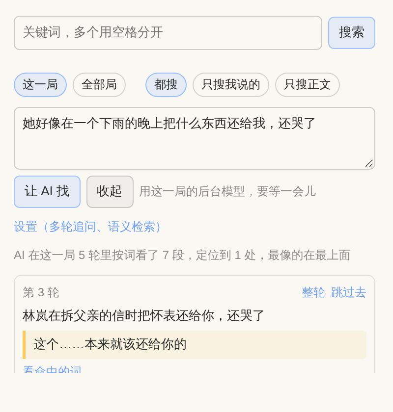
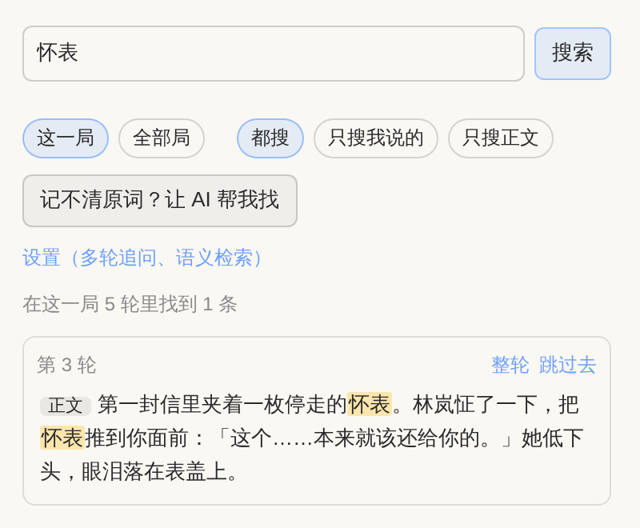

# 搜对话 · dsh-tavern-chat-search

**DSH Tavern 插件：翻聊天记录，记不清原话也能找到。**

聊到几十上百轮以后，想回头看「她当时到底说了什么」「那个承诺是哪一轮许下的」，往上翻很难找到。这个插件在酒馆右侧栏加一页「搜对话」：

- 记得关键词，直接搜。
- 只记得大概发生了什么，就用自己的话描述，让 AI 按情节帮你找到那一段，并摘出原句。
- 点结果就跳到那一句，高亮几秒。

## 能做什么

### 关键词搜索

- 多个词用空格分开，要求同时出现在同一轮里。都对不上时，退一步列出包含其中一部分词的结果。
- 搜索时不区分大小写，也忽略空格和标点，比如搜「没什么只是」能找到「没什么，只是……」。
- 范围可以选**这一局**或**全部局**，内容可以选**只搜我说的**、**只搜正文**或**都搜**。
- 每处命中单独列一行，命中的词会高亮，点哪一行就跳到哪一处。

### 让 AI 帮我找

记不清原词时，点「记不清原词？让 AI 帮我找」，用自己的话描述，比如：

> 她好像在一个下雨的晚上把什么东西还给我，还哭了

1. AI 先把你的描述扩成一组原文里可能出现的词，包括同义词、代称、动作、物品和台词口吻。
2. 插件把对话切成两三百字一段，在本机按这些词给每段打分，挑出最像的 50 段。这一步不调用模型，几百轮的对话也只要几毫秒。
3. AI 读这 50 段，按情节判断哪段是你要找的。结果给出最多 5 处，每处附一句「发生了什么、为什么对得上」，以及逐字摘出的原句。插件会核对原句是否真的出现在原文里，模型编造的句子不会当成原文显示。

如果 AI 觉得这 50 段都不像，会换一批说法再找一轮，已经看过的段不会再给它，最多找 3 轮。每轮调用两次模型，找到就停。用的是这一局的后台模型，不需要另外配置。

### 语义检索（可选）

AI 帮找默认靠词来筛。如果你的描述和原文一个字都对不上，可以在面板的「设置」里打开语义检索：接一个 OpenAI 兼容的向量（embedding）接口，给每段算向量，按意思来找。打开后，按意思最像的 30 段和按词最像的 30 段交错交给 AI 挑。

- 默认填的是[硅基流动](https://siliconflow.cn)的 `BAAI/bge-m3`，中文效果好，填上 Key 就能用。也可以用本地 Ollama，接口地址填 `http://127.0.0.1:11434/v1`，再填模型名。
- 第一次使用会把全部对话算一遍向量，面板上显示进度。向量存在本机，之后只算新增或改动过的段。
- 接口出错时自动退回只按词找，结果上方会说明原因。

### 跳过去

- 点「跳过去」、点命中的那一行，或者点 AI 摘出的原句，都会跳到那一句并高亮几秒。需要时会自动往前加载更早的消息。
- 结果在别的局时，会先切到那一局；切不过去时，提示你先打开那一局。
- 「整轮」可以直接在面板里看这一轮的完整原文。

## 安装

打开 DSH Tavern → 设置 → DSH Tavern → 插件，粘贴本仓库地址 `https://github.com/clanso/dsh-tavern-chat-search`，点「安装」，然后刷新页面。
连不上 GitHub 时，下载本仓库的 ZIP，在同一处点「上传 ZIP」。也可以把整个文件夹手动放进 `~/.dsh/profile-data/tavern/data/plugins/`。

装好后在右侧栏的「＋」里打开「搜对话」。

要求：DSH Tavern 3.x（插件接口第 2 版以上）。AI 帮找需要这一局配了后台模型。

## 费用与隐私

- 关键词搜索完全在本机进行，不调用模型。
- AI 帮找每轮调用两次模型。第一次只发你的那句描述；第二次发 50 段候选，大约一万多字。找到就停，最多 3 轮。
- 语义检索会把对话内容发给你填的向量接口。介意的话用本地 Ollama，或者不打开这个选项。
- 插件只读不写，不会改动对话。设置存在酒馆的插件数据里，向量接口的 Key 存在 DSH 的凭据里，向量缓存在 `~/.dsh/dsh-tavern-chat-search/`。

## 说明

- 对话通过 Tavern 插件接口的 `getTurnState` 和 `getHistory` 读取。读过的局缓存在内存里，没有变化就不重读；回退、编辑或删局后会重新读。
- Tavern 目前没有「列出全部游戏」的接口，所以搜全部局时，插件从 Tavern 数据目录下的 `sessions.json` 读取局号。读不到时，只搜这一局和插件见过的局。
- 开发和测试：`npm test`，不需要安装任何依赖。

## 许可

MIT
